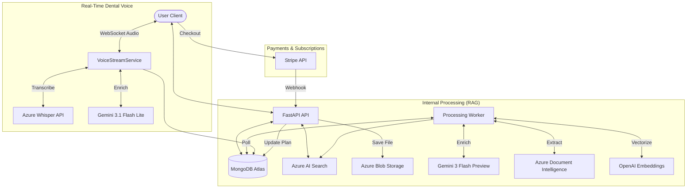

# Petal AI — Backend Architecture & API Catalog

> A comprehensive technical reference for the Petal AI backend infrastructure, security models, and API ecosystem.
>
> **Last Updated:** 2026-10-12

---

## 🏗️ System Blueprint

The Petal AI backend is built on **FastAPI**, designed for high-concurrency clinical workloads. It follows a decoupled architecture where the API handles real-time user requests while dedicated **Background Workers** manage CPU-intensive document ingestion and scheduled cleanup.

### High-Level Flow

---

## 🔐 Authentication & Security

### 1. JWT Strategy
The system uses a **Stateless JWT (JSON Web Token)** strategy for authentication:
-   **Access Token**: Short-lived (60 min) token included in the `Authorization: Bearer <token>` header.
-   **Refresh Token**: Long-lived (7-day) token used to rotate credentials without requiring a re-login.
-   **Middleware**: The `get_current_user` dependency validates the JWT signature, expiration, verifies the user exists in MongoDB, checks `is_active` and `is_verified` flags, and validates the user's organization is active before granting access.
-   **Student Single-Session**: Student accounts enforce single-device login — if a new login occurs, the previous session's JWT is invalidated via `active_session_id` tracking.

### 2. OTP Lifecycle (Email Verification)
Used for Registration and Password Recovery:
-   **Registration**: User creates an account → `is_verified=false` → OTP sent via SMTP (Gmail) → `/verify-email` sets `is_verified=true`.
-   **Forgot Password**: `/send-otp` (purpose: forgot_password) → User submits OTP + New Password to `/forgot-password`.

### 3. DB-Driven Permission System
Beyond role-based guards, the system uses a **database-managed permission matrix** stored in the `role_permissions` collection:
-   **Seed on Startup**: `PermissionService.seed_defaults()` populates default permissions for all roles on first run.
-   **Runtime Check**: Routes use `require_permission("permission_key")` dependency to verify access.
-   **Super Admin Bypass**: Super Admin always bypasses permission checks.
-   **Subscription Gating**: The `PermissionService` also validates active subscription plans, supporting both individual and organization-wide subscriptions.

---

## 📂 Database Schema (MongoDB Collections)

Since Petal AI uses a NoSQL approach (Motor/MongoDB), the schema is flexible but follows these core structures:

| Collection | Role | Key Fields |
| :--- | :--- | :--- |
| **`organizations`** | Multi-Tenancy | `name`, `email`, `auto_delete_sessions`, `is_active`, `logo_url` |
| **`users`** | Identity & Access | `email`, `organization_id`, `role` (super_admin/org_admin/dentist/staff/front_office/student/solo_dentist), `is_verified`, `is_active`, `has_agreed`, `active_session_id`, `account_type` |
| **`dental_voice_sessions`**| Clinical Encounter | `user_id`, `organization_id`, `transcript`, `patient_summary`, `soap_note`, `cdt_codes`, `session_type`, `is_verified` |
| **`audit_logs`** | Security Tracking | `actor_id`, `organization_id`, `action`, `resource`, `resource_id`, `metadata`, `timestamp` |
| **`documents`** | Knowledge Base Metadata| `original_filename`, `file_hash`, `blob_name`, `status` (saved/parsing/parsed/chunking/chunked/embedding/completed/failed/skipped), `total_pages` |
| **`chunks`** | Semantic Fragments | `document_id`, `chunk_hash`, `content`, `embedding`, `image_embedding`, `chapter_name`, `is_latest` |
| **`chats`** | Chat Sessions | `user_id`, `title`, `created_at`, `updated_at` |
| **`messages`** | Chat History | `chat_id`, `role` (user/assistant), `content`, `image_urls`, `sources`, `created_at` |
| **`otps`** | Transient Credentials | `email`, `otp_code`, `purpose`, `expires_at` (TTL index) |
| **`invitations`** | Org Invitation Links | `token` (unique), `expires_at` (TTL index), `organization_id`, `role` |
| **`role_permissions`** | DB-Driven RBAC | `role`, `permissions` (dict of permission_key → bool) |
| **`note_templates`** | SOAP Note Templates | `name`, `content`, `organization_id`, `is_active` |
| **`org_template_variables`** | Template Variables | `organization_id`, custom variable key-value pairs |
| **`plans`** | Subscription Plan Catalog | `name`, `cycle`, `allowed_roles`, `is_active`, features |
| **`subscriptions`** | User Subscriptions | `user_id`, `plan`, `status`, `stripe_subscription_id`, timestamps |
| **`transaction_logs`** | Payment History | `user_id`, `type`, `status`, `created_at` |
| **`cdt_codes`** | CDT Reference Data | `code` (unique), `source_document_id`, category, description |
| **`cdt_documents`** | CDT Codebook Metadata | `status`, `created_at` |
| **`teaching_videos`** | Educational Content | `title`, `url`, `is_active`, `created_by` |
| **`case_study`** | Clinical Case Studies | `case_id`, `title`, `content`, `is_embedded`, `created_by` |

---

## 📡 API Catalog

All endpoints are prefixed with `/api/v1`.

### 1. Authentication (`/auth`) — Rate Limit: 10 req/min
| Endpoint | Method | Use Case |
| :--- | :--- | :--- |
| `/send-otp` | `POST` | Dispatches 6-digit code for registration or password reset. |
| `/register` | `POST` | Initial account creation (requires verification). |
| `/verify-email`| `POST` | Validates OTP and activates the account. |
| `/login` | `POST` | Validates password + reCAPTCHA; issues JWTs. |
| `/google` | `POST` | Social login/signup using Google ID tokens. |
| `/refresh` | `POST` | Rotates Access/Refresh token pairs. |
| `/forgot-password` | `POST` | Resets password using OTP verification. |

### 2. Document Management (`/documents`) — Rate Limit: 30 req/min
| Endpoint | Method | Use Case |
| :--- | :--- | :--- |
| `/check-duplicate`| `POST` | Batch check of file hashes before uploading. |
| `/upload` | `POST` | Uploads binary file + metadata; triggers background worker. |
| `/status-stream` | `GET` | **SSE Stream**: Pushes real-time processing percentages to UI. |
| `/` | `GET` | Lists all documents in the knowledge base (Admin). |
| `/{id}` | `DELETE` | Removes document, chunks, and blobs (Admin/Dentist). |

### 3. Chat & RAG (`/chats`, `/blob`) — Rate Limit: 50 req/min (chat), 30 req/min (blob)
| Endpoint | Method | Use Case |
| :--- | :--- | :--- |
| `/chats` | `POST` | Creates a new conversation with an auto-generated title. |
| `/chats/{id}/stream`| `POST` | **SSE Stream**: The core RAG chat endpoint (Generates AI response). |
| `/chats/upload-images`| `POST` | Uploads user-query images to temporary storage for visual RAG. |
| `/chats/{id}/messages`| `GET` | Fetches full message history for a specific chat. |
| `/blob/...` | `GET` | Serves blob content via SAS-authenticated URLs. |

### 4. User Management (`/users`) — Rate Limit: 20 req/min
| Endpoint | Method | Use Case |
| :--- | :--- | :--- |
| `/users/me` | `GET` | Returns authenticated user's profile, logo, and organization state. |
| `/users/me` | `PUT` | Update profile fields (e.g., full_name). |
| `/users/me/agree-disclaimer` | `POST` | Record user disclaimer acceptance. |
| `/users/` | `GET` | List all users with pagination/filters (Admin only). |
| `/users/{id}` | `GET` | Get specific user details (Admin only). |
| `/users/{id}` | `DELETE` | Delete user account (Super Admin only). |

### 5. Organizations — Super Admin (`/organizations`) — Rate Limit: 20 req/min
| Endpoint | Method | Use Case |
| :--- | :--- | :--- |
| `/` | `POST` | Create new organization (name, email, optional logo). |
| `/` | `GET` | List all organizations. |
| `/{org_id}` | `GET` | Get organization details. |
| `/{org_id}` | `PUT` | Update organization settings. |
| `/{org_id}` | `DELETE` | Permanently delete organization + all data. |
| `/{org_id}/invite` | `POST` | Generate invitation link for the org. |
| `/{org_id}/logo` | `POST` | Upload organization logo. |
| `/audit-logs` | `GET` | System-wide audit logs (HIPAA). |
| `/user-activities` | `GET` | User activation/deactivation activities across all orgs. |
| `/{org_id}/audit-logs` | `GET` | Org-specific audit logs. |

### 6. Organizations — Org Admin (`/org`) — Rate Limit: 20 req/min
| Endpoint | Method | Use Case |
| :--- | :--- | :--- |
| `/dashboard` | `GET` | Organization dashboard. |
| `/members` | `GET` | List org members (with `is_active` filter). |
| `/invite-link` | `GET` | Get/regenerate the registration link. |
| `/members/{user_id}/role` | `PUT` | Change member role (sends notification email). |
| `/members/{user_id}/status` | `PUT` | Activate/deactivate member (sends notification email). |
| `/user-activities` | `GET` | Login/status change activities within the org. |
| `/audit-logs` | `GET` | Org-scoped audit logs. |

### 7. Dental Voice (`/dental-voice`) — Rate Limit: 30 req/min (REST), Unlimited (WebSocket)
| Endpoint | Method | Use Case |
| :--- | :--- | :--- |
| `/ws/voice-stream` | `WS` | Real-time WebSocket connection for streaming audio chunks and returning live transcripts. |
| `/sessions` | `GET` | Fetch list of clinical sessions (Filtered by RBAC Org/User rules). |
| `/sessions/{id}` | `GET` | Get a specific session with audio URL. |
| `/sessions` | `DELETE` | Bulk deletion of clinical sessions (Org Admin only). |
| `/sessions/{id}` | `DELETE` | Delete individual session. |
| `/cdt-lookup` | `POST` | CDT code lookup from transcript. |
| `/generate-notes` | `POST` | Generate SOAP note + patient summary. |
| `/upload-cdt-pdf` | `POST` | Upload CDT codebook PDF. |
| `/cdt-documents` | `GET` | List all uploaded CDT codebooks. |
| `/cdt-documents/{id}` | `DELETE` | Remove CDT codebook and all associated data. |
| `/cdt-codes` | `GET` | List CDT codes (with category/search filters). |

### 8. Analytics (`/analytics`) — Rate Limit: 20 req/min
| Endpoint | Method | Use Case |
| :--- | :--- | :--- |
| `/dashboard` | `GET` | Returns dashboard KPIs (date-range filtered) scoped to Org or Global. Requires `start_date` and `end_date` query params. |

### 9. Templates (`/templates`) — Rate Limit: 30 req/min
| Endpoint | Method | Use Case |
| :--- | :--- | :--- |
| `/` | `GET` | List all global and org-specific SOAP note templates. |
| `/{template_id}` | `GET` | Get full details of a specific template. |
| `/` | `POST` | Create a new template (Admin). |
| `/{template_id}` | `PUT` | Update an existing template (Admin). |
| `/{template_id}` | `DELETE` | Delete a template (Admin). |
| `/enhance` | `POST` | AI-powered template enhancement. |

### 10. Teaching Videos (`/videos`) — Rate Limit: 30 req/min
| Endpoint | Method | Use Case |
| :--- | :--- | :--- |
| `/` | `POST` | Create a new teaching video/podcast (Admin). |
| `/` | `GET` | List teaching videos (Students + Admin). |
| `/{video_id}` | `GET` | Get a single teaching video. |
| `/{video_id}` | `PUT` | Update a video (Admin). |
| `/{video_id}` | `DELETE` | Delete a video (Admin). |

### 11. Case Studies (`/case-studies`) — Rate Limit: 30 req/min
| Endpoint | Method | Use Case |
| :--- | :--- | :--- |
| `/` | `POST` | Create one or multiple case studies with auto-embedding (Super Admin). |
| `/` | `GET` | List all case studies. |
| `/{id}` | `GET` | Get a single case study. |
| `/{id}` | `PATCH` | Update a case study (Super Admin). |
| `/{id}` | `DELETE` | Delete a case study (Super Admin). |
| `/embed` | `POST` | Trigger embedding for all un-embedded cases (Super Admin). |

### 12. Subscriptions (`/subscriptions`) — Rate Limit: 10 req/min
| Endpoint | Method | Use Case |
| :--- | :--- | :--- |
| `/` | `GET` | List authenticated user's subscriptions. |
| `/cancel` | `POST` | Cancel an active subscription. |
| `/resume` | `POST` | Resume a subscription set to cancel at period end. |
| `/plans` | `GET` | Get all active subscription plans (public). |
| `/skip-trial` | `POST` | Skip trial phase and start full benefits. |

### 13. Stripe Payments (`/stripe`) — Rate Limit: Unlimited
| Endpoint | Method | Use Case |
| :--- | :--- | :--- |
| `/create-checkout-session` | `POST` | Start a Stripe Checkout Session for a plan. |
| `/webhook` | `POST` | Stripe webhook endpoint for payment events. |
| `/verify-payment/{session_id}` | `GET` | **SSE Stream**: Poll payment verification status. |
| `/transactions` | `GET` | List global transaction logs (Admin only). |

### 14. Speech (`/speech`) — Rate Limit: 10 req/min
| Endpoint | Method | Use Case |
| :--- | :--- | :--- |
| `/token` | `GET` | Get Azure Speech token for client-side TTS. |

### Utility
| Endpoint | Method | Use Case |
| :--- | :--- | :--- |
| `/health` | `GET` | Service health check. |

---

## ⚙️ Background Tasks & Orchestration

The system uses an **`asyncio` Event Loop** to run multiple background workers as coroutines alongside the main API.

### 1. Processing Worker (`processing_worker.py`)
1.  **Notification**: The API calls `notify_new_document()` after a successful upload.
2.  **State Machine**: The worker cycles documents through statuses: `saved` → `parsing` → `parsed` → `chunking` → `chunked` → `embedding` → `completed`.
3.  **Concurrency Management**:
    -   **Parsing**: Parallel 100-page batches.
    -   **Embedding**: Throttled semaphores to prevent Azure/OpenAI rate limits (429 errors).
4.  **Crash Recovery**: `recover_stuck_documents()` runs on startup to reset documents stuck in intermediate states.
5.  **Graceful Shutdown**: The worker task is cancelled on SIGTERM, with `CancelledError` handled cleanly.

### 2. SOAP Retention Worker (`soap_retention_worker.py`)
-   Runs as a daily background task.
-   Enforces each organization's `auto_delete_sessions` policy (typically 30-day threshold).
-   Purges expired dental voice sessions from MongoDB and Azure Blob Storage.

### 3. Startup Seeding
On application startup, the lifespan context manager also:
-   Seeds default role permissions via `PermissionService.seed_defaults()`.
-   Seeds default SOAP note templates via `TemplateService.seed_default_templates()`.

---

## 🛠️ Middleware & Core Utilities

-   **CORS Middleware**: Configured in `main.py` to allow specific origins (`localhost:3000`, `smileguideai.com`, `app.smileguideai.com`).
-   **Auth Middleware**: `AuthMiddleware` — validates JWT on every request (before route handlers).
-   **Rate Limiting Middleware**: `RateLimitMiddleware` — global suspicious-pattern blocking + per-route sliding window via `RateLimiter` dependency.
    -   Blocks known malicious scan patterns (`.env`, `.git`, `wp-admin`, etc.).
    -   Permanently bans repeat offenders.
    -   Per-route limits: Auth (10/min), Users (20/min), Documents (30/min), Chat (50/min), Analytics (20/min), Templates (30/min), Videos (30/min), etc.
-   **Security**: Uses `passlib (bcrypt)` for password hashing and `python-jose` for JWT operations.
-   **Email**: Integrated with **SMTP (Gmail)** for OTP delivery, role-change notifications, activation/deactivation emails, and invitation emails.
-   **Storage**: **Azure Blob Storage** for raw document persistence, figure extraction, organization logos, and audio recordings.
-   **Process Manager**: **PM2** via `ecosystem.config.js` for production process management.
-   **Deployment**: Shell-based deployment via `deploy.sh` (tar → SCP → PM2 restart).
