# Petal AI — RAG Pipeline Workflow

> Full lifecycle: Upload → Parsing → Chunking → Clinical Enrichment → Embedding → Retrieval → Scoring → Chat
>
> **Last Updated:** 2026-10-12

---

## 🏗️ Architecture Overview

```mermaid
flowchart TD
    subgraph "Ingestion (Background)"
        A[Upload API] --> B[Azure Blob]
        A --> C[(MongoDB status=saved)]
        C --> D[Processing Worker]
        D -->|PDF| E[parse_pdf.py]
        E --> F[chunk_pdf.py]
        F --> G[embed_chunks.py]
        G --> H[Azure AI Search Index]
        
        subgraph "Enrichment"
            F <-->|SHA-256| FV[Gemini 3 Flash Preview]
            FV --> FC[(MongoDB Enrichment Cache)]
        end
    end

    subgraph "Retrieval (Real-time)"
        Q[User Query] --> QA[Query Analysis]
        QA -->|Gemini/Regex| QR[Standalone Rewrite]
        QR --> PS[Parallel Search]
        PS -->|Image URL| IV[Azure Vision Vectorize]
        QR --> T[dental-text-index]
        IV & QR --> I[dental-image-index]
        T & I --> M[Merge & Dedupe]
        M --> SC[Clinical Scoring]
        SC --> DIV[Diversity Capping]
        DIV --> LLM[Gemini 3 Flash Preview]
    end
```



---

## 📡 RAG Service Architecture

The RAG pipeline is modularized into a `rag_service/` package with clear separation of concerns:

| Module | Responsibility |
| :--- | :--- |
| `query_analysis.py` | Gemini-powered query rewriting, context resolution, regex fallback |
| `search.py` | Parallel Azure AI Search across text and image indices |
| `embeddings.py` | OpenAI embedding generation for query vectors |
| `scoring.py` | Clinical relevance scoring, diversity capping, tie-breaking |
| `retrieval.py` | Orchestrates the full retrieval pipeline end-to-end |
| `results.py` | Result formatting, SAS URL generation, deduplication |
| `clients.py` | Azure AI Search and embedding client initialization |

The chat layer is similarly modularized in `message_service/`:

| Module | Responsibility |
| :--- | :--- |
| `message_service.py` | Core chat logic, SSE streaming, conversation management |
| `context_builder.py` | Builds LLM context from retrieved chunks + conversation history |
| `llm_clients.py` | Gemini/OpenAI client initialization and streaming |

---

## ⚡ Speed Optimizations

To target low-latency responses in a clinical pipeline, the system utilizes several design optimizations:

| Category | Optimization | Implementation | Target Impact |
| :--- | :--- | :--- | :--- |
| **Retrieval** | **Matryoshka Slicing** | Truncating OpenAI 3072D vector to 1024D for image index | Avoids redundant embedding API calls |
| **Retrieval** | **Regex Fallback** | `_needs_analysis` heuristic skips Gemini for simple queries | Reduces latency for factual questions |
| **Retrieval** | **Barrier-Free Parallelism** | Concurrent search across both indices + History loading | Maximizes concurrent execution |
| **Retrieval** | **SAS Batching** | `asyncio.to_thread` for blob URL generation | Minimizes blocking IO wait times |
| **Ingestion** | **Vision Caching** | SHA-256 image hashing | Reuses enrichment results for repeated images |
| **Ingestion** | **Batch Processing** | Concurrent 100-page processing for large PDFs | Speeds up ingestion for heavy textbooks |

---

## Phase 1: Parsing → `parse_pdf.py`

**Model**: Azure Document Intelligence `prebuilt-layout` (v4.0)  
**Strategy**: The parsing layer is designed to handle high-volume ingestion using the S0 Standard tier. For documents exceeding 100 pages, the pipeline is designed to split the file into concurrent batches to maintain throughput and respect API timeouts.

---

## Phase 2: Chunk Construction Strategy → `chunk_pdf.py`

Unlike basic splitters that use raw text streams, this pipeline builds chunks from **structured layout elements** provided by Azure Document Intelligence.

1.  **Layout-Aware Construction**: Final chunks are composed of specific elements (paragraphs, headings) identified by the parser. 
2.  **Noise & Span Filtering**: To maintain search hygiene, the system is designed to **exclude figure and table spans** from text chunks. This prevents figure callouts or table fragments from polluting the semantic embedding of text.
3.  **Tiktoken Integration**: Uses the `cl100k_base` tokenizer for precision size control.
4.  **Semantic Continuity**: Chunks are designed to snap to the nearest sentence end (approx. 500-1000 words) to ensure clinical propositions are preserved.
5.  **Hierarchy Preservation**: Chunks are grouped by their 3-level section hierarchy (Chapter → Topic → Subheading).
6.  **Overlap**: A configurable overlap (typically 50 tokens) is applied to maintain context across chunk boundaries.

---

## Phase 3: Retrieval-Oriented Clinical Enrichment → `chunk_pdf.py`

**Expert Model**: `gemini-3-flash-preview`

Every figure (image/X-ray) extracted by the parser is enriched with clinical metadata to broaden its retrieval surface:
-   **Structured Visual Description**: A retrieval-oriented description of visual findings (borders, texture, density) to allow for clinical keyword matching.
-   **Clinical Attributes**: Extraction of normalized `modality`, `anatomy`, `visual_signs`, and `candidate_conditions`.
-   **Enrichment Cache**: To avoid redundant API costs, analysis results are keyed by the image's SHA-256 hash and stored in the `clinical_enrichment_cache` (MongoDB). Repeated figures across different chapters/books reuse the same analysis.

---

## Phase 4: Embedding & Indexing → `embed_chunks.py`

### 🔤 Text/Table Index (`3072D`)
-   **Model**: `text-embedding-3-large` vectorize the full context (Metadata + Content).

### 🖼️ Image/Figure Index (Duality of Vector Roles)
The image index utilizes two distinct vector fields to support different retrieval intents:
1.  **Content Vector (1024D)**: Vectorized Rich Metadata. This supports **Text-to-Image Semantic Search**, allowing the system to find an image based on clinical description.
2.  **Image Vector (1024D)**: Vectorized image bytes via `Azure Vision`. This supports **Visual Similarity Search**, allowing the system to find similar clinical appearances.
    -   *Optimization*: Re-normalized Matryoshka slicing (3072D → 1024D) is typically used to populate the `content_vector` without a second embedding call.

### 🔍 Additional Search Indices
| Index | Dimensions | Purpose |
| :--- | :--- | :--- |
| `dental-text-index` | 3072D | Primary text/table chunk retrieval |
| `dental-image-index` | 1024D (dual) | Image similarity + text-to-image search |
| `dental-cdt-index` | — | CDT code semantic matching |
| `dental-casestudy-index` | — | Case study similarity search (threshold: 0.70) |

---

## Phase 5: Smart Versioning & Deduplication

How the system handles "slightly edited" or re-uploaded documents:

1.  **Cross-Document Payload Reuse**: Before generating new embeddings, the system is designed to check for identical chunks (via SHA-256 content hash) in the global database. If a chunk with the same text/image-hash already exists, the pipeline **reuses the existing vector and clinical enrichment**. This ensures that if a user edits only 5% of a textbook, 95% of the vectors are reused instantly without new API costs.
2.  **Semantic Deduplication**: The pipeline aims to check for semantic duplicates (>90% similarity) already in the search index. This prevents near-identical facts from appearing multiple times in the LLM's context.
3.  **Lifecycle Metadata Tracking**: For every chunk, we typically track:
    -   `created_at`: Original ingestion timestamp.
    -   `embedded_at` & `indexed_at`: Tracking the throughput of the vector pipeline.
    -   *Note*: While these timestamps are tracked in MongoDB for auditing, they are typically excluded from the search index to keep the RAG results focused on evergreen content rather than temporary file versions.

---

## Phase 6: Multimodal Retrieval → `rag_service/`

The system is designed to handle multimodal queries through weighted signal fusion.

1.  **Query Analysis** (`query_analysis.py`): `gemini-3-flash-preview` aims to rewrite the question into a `standalone_query` while resolving conversational context from history. A regex fallback heuristic (`_needs_analysis`) skips Gemini for simple factual queries to reduce latency.
2.  **Weighted Multi-Vector Search** (`search.py`):
    -   **Visual Similarity Match**: Weight = **3.0** (High priority for image-driven queries).
    -   **Text-to-Image Semantic Match**: Weight = **0.7**.
    -   **Text-to-Text Semantic Match**: Weight = **0.9**.
3.  **Signal Synergy**: The text and visual signals are complementary, ensuring that the system can match both the "look" of an image and the "meaning" of its description.

---

## Phase 7: Diversity & Scoring → `rag_service/scoring.py`

1.  **Visual Match Tie-Breaker**: A soft boost (typically 5-10%) is applied to Figures if query keywords match the figure caption.
2.  **Diversity Control (Tunable)**: The system utilizes a **Diversity Capping** mechanism (typically limiting retrieval to 3 chunks per document). This is a tunable control designed to ensure evidence is drawn from multiple sources and to prevent a single document from dominating the LLM's context window.

---

## Glossary of Models

| Component | Model Name | Role |
| :--- | :--- | :--- |
| **Embedding** | `text-embedding-3-large` | 3072D and 1024D Vector generation |
| **Extraction** | `Azure DI prebuilt-layout` | PDF structure and table parsing |
| **Vision** | `Azure Vision v3.2` | Vectorize image bytes for similarity search |
| **Chat (Primary)** | `gemini-3-flash-preview` | Clinical context-aware answer generation |
| **Analysis** | `gemini-3-flash-preview` | Clinical enrichment and Query analysis |
| **Voice Extraction** | `gemini-3.1-flash-lite` | Entity extraction and SOAP note generation |
| **Transcription (STT)** | `gemini-3.6-flash` | Audio transcription (STT) for voice sessions |
| **Transcription** | `Azure Whisper API` | Streaming clinical voice-to-text |
| **Tokenizer** | `tiktoken (cl100k_base)` | Precision token-boundary calculation |

---

## 🎙️ Dental Voice & Coding Pipeline

Alongside document RAG, the Petal AI backend handles real-time ambient listening via the Dental Voice module.

```mermaid
flowchart TD
    subgraph "Real-Time Clinic Capture"
        Client([Dentist App]) <-->|WebSocket (PCM Audio)| VS[VoiceStreamService]
        VS -->|Buffer Audio| AW[Azure Whisper API]
        AW -->|Transcript Chunk| VS
        VS -->|Live Transcript| Client
    end

    subgraph "Post-Session Processing"
        VS -->|Full Transcript| G[Gemini 3.1 Flash Lite]
        G -->|Extract| Ent[Clinical Entities]
        G -->|Generate| SOAP[SOAP Note & Summary]
        
        Ent --> CDT[CDT Lookup Service]
        CDT -->|Vector Match| AIS[(Azure AI Search / Direct JSON)]
        AIS -->|Matched Codes| DB[(MongoDB)]
        SOAP --> DB
    end
```

### Phase 1: Real-Time Audio Transcription
-   **Service**: `VoiceStreamService` (WebSockets)
-   **Model**: Azure OpenAI Whisper API
-   **Flow**: The client streams raw PCM audio chunks over a secure WebSocket. The backend buffers these chunks and periodically sends them to Azure Whisper, emitting live transcription text back to the client interface.

### Phase 2: Clinical Entity Extraction
-   **Model**: `gemini-3.1-flash-lite`
-   **Flow**: Once the session ends, the full transcript is sent to Gemini with a strict JSON schema to extract:
    - `chief_complaint`
    - `medical_history_changes`
    - `teeth_mentioned`
    - `findings`
    - `procedures_performed`

### Phase 3: Automated Documentation
-   **Model**: `gemini-3.1-flash-lite`
-   **Flow**: Using the extracted entities, the system auto-generates a formatted **SOAP Note** (Subjective, Objective, Assessment, Plan) tailored to dental standards, alongside a lay-friendly **Patient Summary**. SOAP note formatting is driven by customizable **note templates** (`note_templates` collection) with org-level variable overrides.

### Phase 4: Medical Coding (CDT)
-   **Service**: `CDTService` / `CDTServiceDirect`
-   **Flow**: The clinical findings and treatments are mapped directly to American Dental Association (ADA) CDT codes using semantic matching (via `dental-cdt-index`) or direct JSON lookups. The resulting codes are embedded into the session record for automated billing workflows.

---

## 📚 Case Study Pipeline

Case studies are clinical reference materials that can be embedded and retrieved alongside the main knowledge base:

1.  **Creation**: Super Admin creates case studies via `POST /api/v1/case-studies` (supports batch creation).
2.  **Auto-Embedding**: Immediately triggers background embedding via `embed_all_case_studies()`.
3.  **Retrieval**: Case studies are indexed in `dental-casestudy-index` with a similarity threshold of 0.70.
4.  **Deduplication**: Duplicate `case_id` values are automatically skipped during creation.
