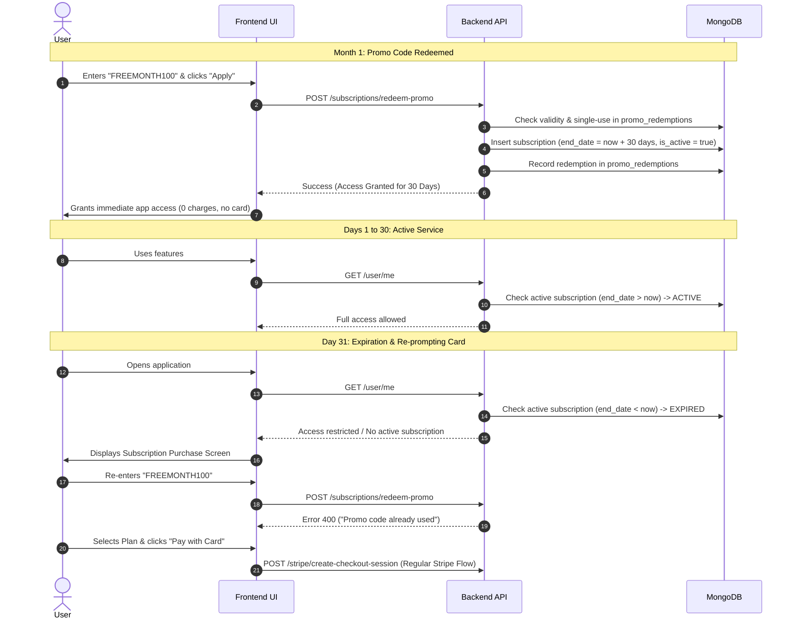
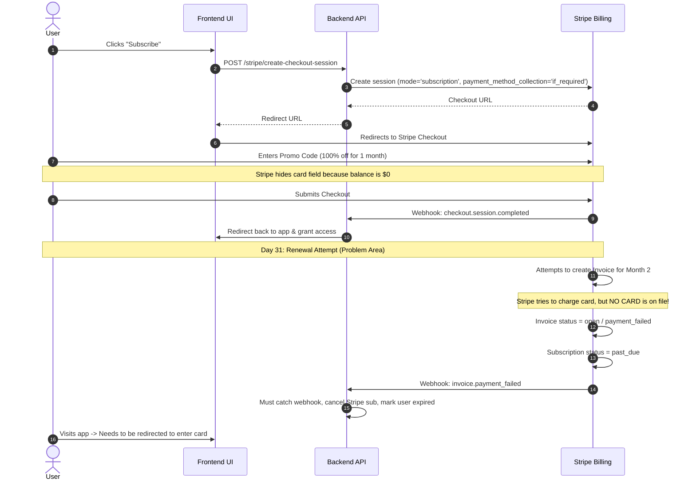

# Promo Code Implementation: Custom Backend vs. Stripe

## Executive Summary

The objective is to allow users to enter a promo code (such as `FREEMONTH100`) on the subscription purchase screen to receive **1 month of free access without entering credit card details**. After the 30-day period expires, the user must be prompted with the subscription purchase screen again, this time requiring credit card details.

This document compares implementing this flow via **Custom Backend Direct Grant** vs. **Stripe-Managed Checkout**.

---

## High-Level Comparison Matrix

| Criteria | Custom Backend Direct Grant (Recommended) | Stripe Checkout (100% Coupon / Trial) |
| :--- | :--- | :--- |
| **Credit Card Requirement** | ❌ **Completely skipped.** Zero credit card or billing details required. | ⚠️ **Complex configuration.** Requires `payment_method_collection: 'if_required'` and custom invoice management. |
| **User Experience (UX)** | 🚀 **Frictionless & Instant.** User enters code, clicks "Apply", and immediately gains access without leaving the app. | 🐢 **Redirect friction.** User is redirected to Stripe-hosted checkout (or embedded iframe) just to submit a $0 checkout. |
| **Month 2 Expiration & Paywall** | ✅ **Clean & Automatic.** Subscription record naturally expires on Day 31 (`end_date < now`). The purchase screen seamlessly reappears. | ⚠️ **Invoice Failure / Past Due.** Stripe expects recurring payment. With no card on file, Stripe generates unpaid invoices, sets status to `past_due`, and runs retry/dunning flows. |
| **Stripe Account Hygiene** | ✅ **Clean.** No ghost customer profiles, $0 transaction logs, or unpaid invoices in your Stripe dashboard. | ❌ **Cluttered.** Creates Stripe customer records and dangling subscriptions for trial users who may never convert. |
| **Abuse & Re-use Control** | ✅ **Full Control.** Verified directly against local database (`promo_redemptions`) per user ID or organization ID. | ⚠️ **Limited.** Stripe promo codes support global redemption limits, but enforcing 1 per user/organization requires backend logic anyway. |
| **Implementation Complexity** | 🟢 **Low.** 1 API endpoint (`/subscriptions/redeem-promo`), 1 validation check, and inserting a subscription document with `end_date`. | 🔴 **High.** Involves coordinating Stripe Checkout sessions, webhook listeners (`invoice.payment_failed`, `customer.subscription.deleted`), and dunning policies. |

---

## Detailed Architectural Breakdown

### Approach A: Custom Backend Direct Grant (Recommended)

In this approach, Stripe is not involved until the user actually enters a credit card to pay for Month 2.

#### Why it works best:
1. **Built-in Expiration Check**: The existing `SubscriptionService.get_active_subscription` in Petal AI already filters by `{"end_date": {"$gt": now}}`. Once the 30-day mark passes, the backend automatically reports no active subscription without needing external triggers.
2. **Zero Financial Liabilities**: No possibility of accidental customer credit card charges during Month 1.
3. **Targeted Eligibility**: Promo codes can be restricted by user role (e.g., dentist only), organization type, or expiration dates.

---

### Approach B: Doing it via Stripe

In this approach, Stripe handles the promo code via Stripe Coupons and Promotion Codes.

#### Complications with the Stripe-only approach:
1. **Payment Method Collection**: By default, Stripe Subscription checkout requires a payment method even if the first invoice is $0. Setting `payment_method_collection: 'if_required'` allows skipping the card, but Stripe still considers it an ongoing recurring subscription.
2. **Failed Invoice Dunning**: When Month 2 starts, Stripe tries to bill the customer. Having no card on file causes the invoice to immediately fail, generating `invoice.payment_failed` webhooks and marking the customer `past_due`.
3. **Stripe Dashboard Noise**: Hundreds or thousands of users testing a promo code create incomplete/past-due subscriptions and customer entities in Stripe, making Stripe revenue metrics inaccurate.
4. **If a card *is* captured**: If you capture a card upfront with a 100% off coupon, Stripe will silently charge the card on Day 31 **without** showing the subscription purchase screen again, violating the desired behavior.

---

## Technical Recommendation

**Implement the Custom Backend Direct Grant.**

It fulfills every requirement cleanly:
- Card entry is skipped entirely during promo redemption.
- Free access lasts exactly 30 days.
- When 30 days elapse, the purchase screen re-emerges automatically.
- Users cannot re-use the code and must enter their card details to continue.
